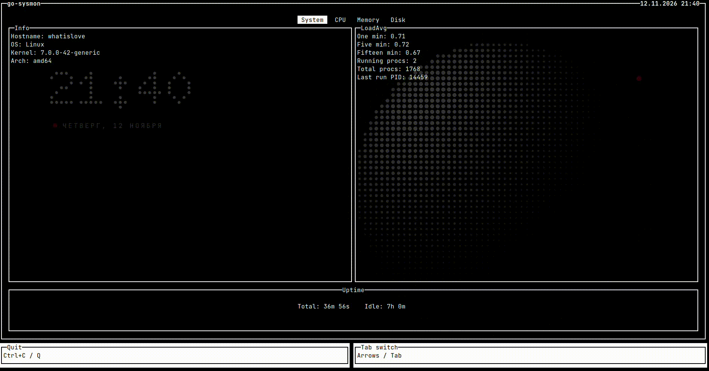

# Terminal system monitor for Linux
System info, CPU, memory and disk usage on four tabs, one keypress apart.



## Install

Download the `.deb` for your architecture (amd64 or arm64) from
[Releases](https://github.com/tinkyrain/go-sysmon/releases) and install it:

```bash
go install github.com/tinkyrain/go-sysmon/cmd/go-sysmon@latest   # or
sudo apt install ./go-sysmon_*.deb
```

Or build from source (Go 1.24+):

```bash
git clone https://github.com/tinkyrain/go-sysmon.git
cd go-sysmon
go build -o go-sysmon ./cmd/go-sysmon
```

## Usage

```bash
go-sysmon            # start the dashboard
go-sysmon --version  # print version
```

| Key | Action |
|---|---|
| `←` `→` | previous / next tab |
| `Tab` | next tab, wraps to the first |
| `q` / `Ctrl+C` | quit |

### Tabs

- **System** — hostname, OS, kernel, architecture, load average and uptime
- **CPU** — total load plus the busiest cores, as many as the window fits
- **Memory** — RAM and swap, used percentage and absolute sizes
- **Disk** — total and available space per mounted filesystem

The layout follows the terminal: resize the window and the pages re-fit to it.

## Configuration

Optional. Create `~/.config/go-sysmon/config.toml`:

```toml
interval  = "3s"     # how often metrics refresh
proc_root = "/proc"  # path to procfs
```

The values above are the defaults.

## License

MIT
